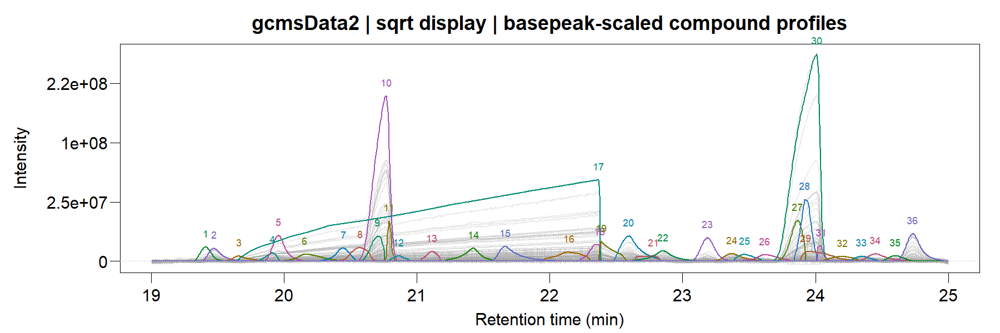
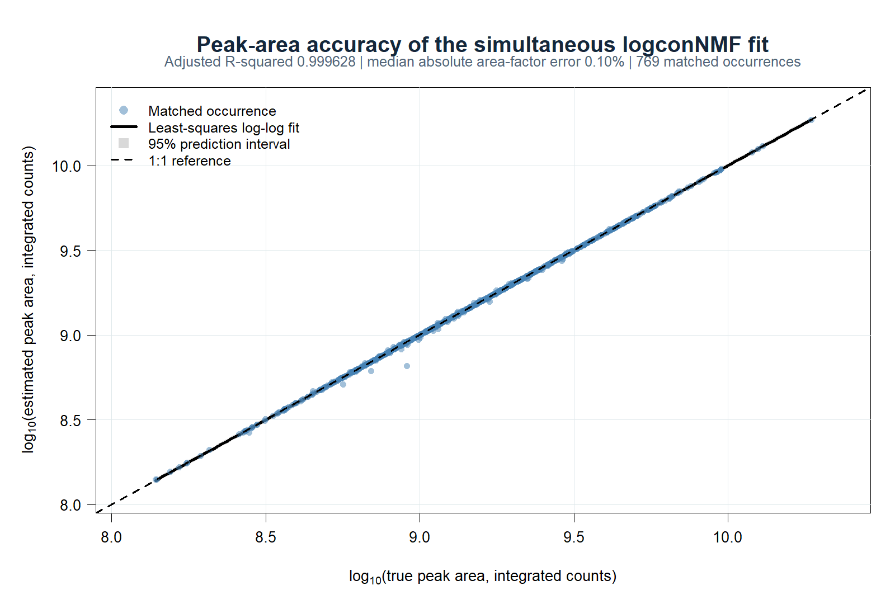
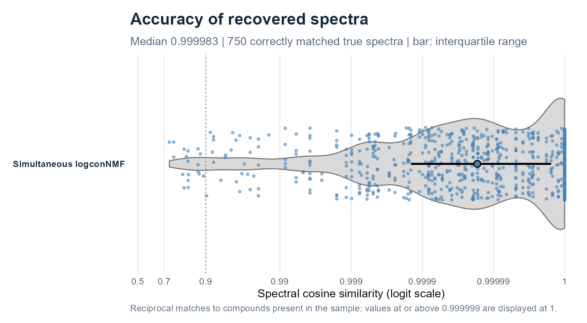
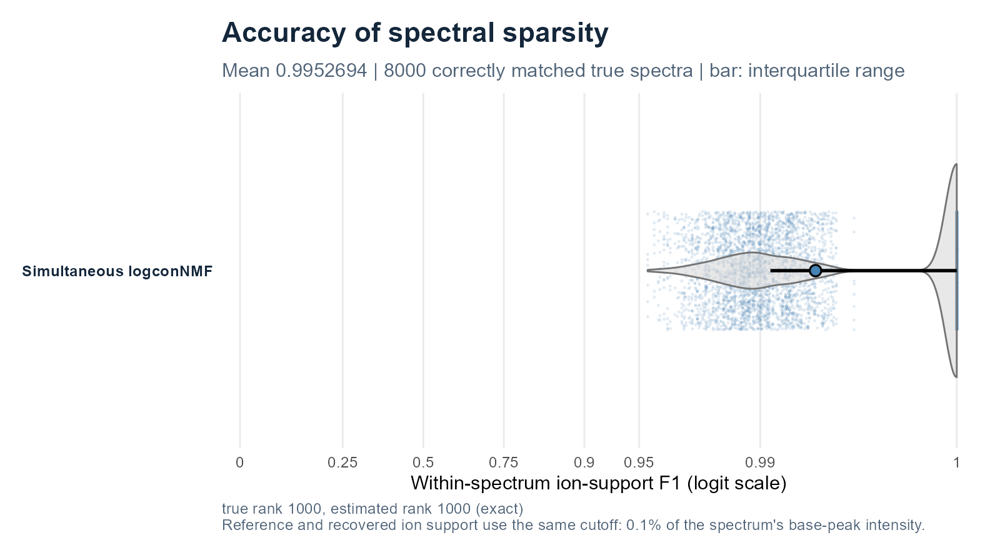
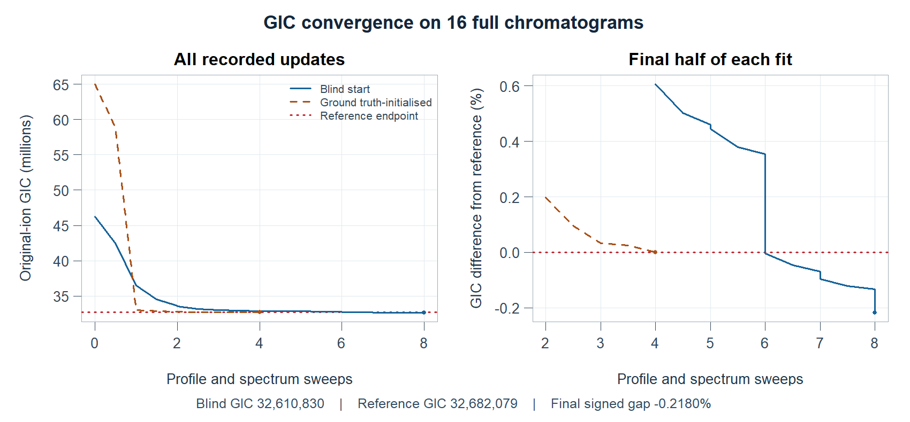
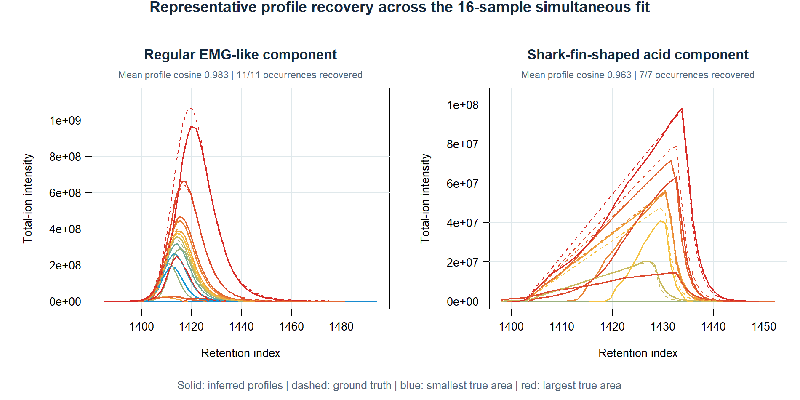

# logconNMF: Log-Concave Nonnegative Matrix Factorization with Automatic Rank Selection

<a href="https://tomwenseleers.github.io/logconNMF/">
<picture>
  <source media="(prefers-color-scheme: dark)" srcset="logconNMF/man/figures/logo-dark.svg">
  <source media="(prefers-color-scheme: light)" srcset="logconNMF/man/figures/logo-light.svg">
  
</picture>
</a>

[Get started](https://tomwenseleers.github.io/logconNMF/articles/log-concave-nmf.html) · [Documentation](https://tomwenseleers.github.io/logconNMF/reference/index.html) · [Algorithm & theory](https://tomwenseleers.github.io/logconNMF/articles/algorithm.html)

**A structured sparse nonnegative factorisation framework for ordered multichannel data, combining automatic rank selection, hard log-concave profiles, flexible likelihoods supporting different noise models and simultaneous multisample models that do not require trilinearity.**

## Nonnegative matrix and tensor factorisation to separate overlapping peaks

Hyphenated chromatography is a demanding test case for structured NMF and
tensor decomposition. In gas chromatography–mass spectrometry (GC–MS),
chromatographic separation is rarely complete: when compounds co-elute, the
spectrum observed at one scan is an additive mixture of their spectra. In
matrix notation,

```math
\mathbf{Y}_{i\boldsymbol{\cdot}}
\approx \sum_{r=1}^{R} H_{ir}\mathbf{S}_{r\boldsymbol{\cdot}}
+ \mathbf{B}_{i\boldsymbol{\cdot}},
```

where $`\mathbf{H}_{\boldsymbol{\cdot}r}`$ is the elution-mode factor,
$`\mathbf{S}_{r\boldsymbol{\cdot}}`$ is the spectral-mode factor for component
$`r`$, and $`\mathbf{B}_{i\boldsymbol{\cdot}}`$ represents the smooth background
at scan $`i`$. Recovering the latent components is therefore a
constrained nonnegative factorisation problem: model order must be identified
while chemically meaningful structure is imposed on both modes.

Nonnegative matrix and tensor factorisation have a substantial history in
hyphenated chromatography. Important examples include
[MCR-ALS](https://doi.org/10.1039/C4AY00571F),
[NMF applied directly to GC–MS](https://doi.org/10.1016/j.talanta.2004.09.017),
[nonnegative unimodal matrix factorisation](https://doi.org/10.1109/ICASSP39728.2021.9414631),
[global parametric analysis of multiple GC/MS data sets](https://doi.org/10.1016/j.chemolab.2008.10.004),
[PARAFAC2 for retention-time shifts](https://doi.org/10.1002/%28SICI%291099-128X%28199905/08%2913%3A3/4%3C295%3A%3AAID-CEM547%3E3.0.CO%3B2-Y),
and the PARAFAC2-based
[PARADISe workflow](https://doi.org/10.1016/j.chroma.2017.04.052), including its recent
[shift-invariant trilinearity formulation](https://doi.org/10.1002/cem.3501).
These methods established that multichannel structure can resolve co-elution
and recover spectra with less interference than apex extraction alone.
For the factorisation community, these data expose where unconstrained
bilinear models and rigid multilinear coupling become fragile: rank, profile
geometry, observation noise, background and between-sample variation all
interact.

### What standard formulations leave unresolved

- **Optimisation and chemical rank.** Bilinear and multilinear factorisations
  are nonconvex. Different starts can give different stationary solutions,
  while ALS algorithms may enter long *swamps* or stop at a poor local fit
  ([Boutsidis & Gallopoulos, 2008](https://doi.org/10.1016/j.patcog.2007.09.010);
  [Tomasi & Bro, 2006](https://doi.org/10.1016/j.csda.2004.11.013)). The number
  of components is usually supplied or selected outside the main fit. Useful
  diagnostics and automated classifiers exist for PARAFAC/PARAFAC2
  ([Bro & Kiers, 2003](https://doi.org/10.1002/cem.801);
  [Johnsen et al., 2014](https://doi.org/10.1002/cem.2575)), but require fitting
  and comparing a sequence of prespecified ranks.
- **Peak geometry.** Nonnegativity alone permits multimodal or jagged elution
  profiles. MCR-ALS can impose unimodality
  ([Bro & Sidiropoulos, 1998](https://doi.org/10.1002/%28SICI%291099-128X%28199807/08%2912%3A4%3C223%3A%3AAID-CEM511%3E3.0.CO%3B2-2)),
  but unimodality by itself permits shoulders, plateaus and irregular tails.
  A more appropriate peak-shape constraint would be log-concavity, which is stronger:
  when imposed on the positive support, it requires
  $`\displaystyle \Delta^2\log h_i = \log h_{i+1}-2\log h_i+\log h_{i-1}\leq 0`$,
  which implies unimodality
  while still allowing asymmetric and long-tailed peaks.
- **Instrument response, background and noise.** Standard factorisations do
  not jointly estimate a constant or smoothly time-varying point-spread
  function (PSF) and a smooth nonnegative background. Least squares also
  imposes a constant-variance Gaussian working model. Ion production and
  arrival motivate count models, while detector gain, aggregation and chemical
  variability can produce overdispersion or approximately Gaussian intensities
  ([Ipsen, 2015](https://doi.org/10.1021/ac503554u)). Although Poisson MCR has
  been proposed—in the NMF literature, the corresponding Poisson-likelihood
  formulation is known as Kullback–Leibler NMF
  ([Cichocki et al., 2009](https://doi.org/10.1002/9780470747278);
  [Lavoie et al., 2016](https://doi.org/10.1016/j.chemolab.2016.02.006))—it is a
  specialised extension that has not been routinely used in the chemometrics
  literature and does not account for overdispersion.
- **Multiple samples.** PARAFAC assumes trilinearity: apart from an amplitude,
  each compound has the same elution profile in every sample. Shifted PARAFAC
  adds translations but not compound- and concentration-specific broadening or
  tailing. Classical PARAFAC2 is more flexible, but still requires
  $`\mathbf{H}_s^{\mathsf T}\mathbf{H}_s=\boldsymbol{\Phi}`$ for every sample
  $`s`$. Retention shifts can preserve
  these cross-products; changing widths, tails and pairwise overlaps generally
  do not. Flexible and fully constrained PARAFAC2 variants relax important
  parts of this restriction
  ([Cohen & Bro, 2018](https://doi.org/10.1007/978-3-319-93764-9_9);
  [Roald et al., 2022](https://doi.org/10.1137/21M1450033)).

| Method (typical cited formulation) | Rank selection | Chromatographic profile | Nonnegativity | Joint component selection across channels | Optimal spectral sparsity | Noise objective | Multiple samples | Rank and scope in the cited formulation |
|:--|:--|:--|:--|:--|:--|:--|:--|:--|
| [MCR-ALS / NMF](https://doi.org/10.6028/jres.124.018)<sup>†</sup> ([GC–MS NMF](https://doi.org/10.1016/j.talanta.2004.09.017); [unimodal NMF](https://doi.org/10.1109/ICASSP39728.2021.9414631)) | Supplied; external EFA/PCA diagnostics | Optional unimodality and other constraints, but no hard log-concavity | Both factors in standard NMF and NNLS-constrained MCR; optional in broader MCR | No | No | Least squares is usual; generalized KL and specialised Poisson extensions exist | Separate, augmented or shared-factor multiset fits | Chosen for the mixture or interval being resolved |
| PARAFAC / shifted PARAFAC | Supplied; external diagnostics | One shared profile per compound; shifted variant adds translation | Optional | No | No | Least squares in standard algorithms | Exact trilinearity, or sample shifts only | Chosen for the sample tensor or interval |
| [Classical PARAFAC2 / PARADISe](https://doi.org/10.1016/j.chroma.2017.04.052) | Usually supplied; multi-rank diagnostic automation has been proposed | Sample-specific profiles with a constant cross-product constraint; no hard chromatographic shape | Historically not on every mode | No | No | Least squares | Retention drift and restricted shape variation | PARADISe compares candidate ranks within each chromatographic interval |
| Flexible / [fully constrained PARAFAC2](https://doi.org/10.1137/21M1450033) | Supplied externally | Optional nonnegativity, smoothness or unimodality; relaxed/flexible coupling | Can constrain every mode | No | No | Least squares in the cited formulation | More flexible drift and shape variation, with an explicit coupling penalty or constraint | Fitted at the chosen order |
| [Shift-invariant trilinearity](https://doi.org/10.1002/cem.3501) | Supplied externally | A shared peak shape up to translation; cannot model sample-specific shape changes | Can constrain all modes | No | No | Least squares | Retention shifts under shift-invariant trilinearity | Evaluated on low-rank windows; whole chromatograms still require many separate models |

<small><sup>†</sup> When both factors are constrained nonnegative and each alternating least-squares step uses nonnegative least squares under a squared-error loss, MCR-ALS and standard least-squares NMF solve the same constrained bilinear factorisation ([Camp, 2019](https://doi.org/10.6028/jres.124.018)). **MCR-ALS** remains the established name in chemometrics and is the broader framework because its regressors and constraints need not be nonnegative least squares.</small>

The cited chromatographic workflows choose rank for a matrix or retention interval. In PARADISe, intervals are selected to contain preferably fewer than six peaks. The rank of a whole chromatogram counts compounds across all intervals. [PARADISe workflow](https://doi.org/10.1016/j.chroma.2017.04.052)

### What logconNMF adds to constrained factorisation

**logconNMF estimates the number of components from the data while fitting the
chromatographic model.** Its main design choices are:

- **Grouped peak selection.** Candidate peak positions are selected jointly
  across detector channels, so evidence is pooled across mass channels rather
  than thresholded ion by ion.
- **Optimal spectral sparsity.** Within retained components,
  sparsity-promoting penalised regression favours parsimonious ion support and
  hence optimal spectral sparsity.
- **Automatic rank selection.** Score additions, deletions and fusions by penalised
  likelihood to obtain the most parsimonious rank.
- **Hard log-concave profiles.** Every retained elution profile is nonnegative,
  contiguous and log-concave. The condition is stronger than unimodality and is
  enforced during fitting rather than applied as a post-hoc peak cleanup.
- **PSF estimation without a universal final peak shape.** `estimatePSF()` can
  estimate a constant or smoothly time-varying instrument response for sparse
  initialisation. The blind constant-PSF model is a constrained lag-separable form
  of convolutive NMF: its lag matrices share one spectral factor and differ
  only by a PSF ordinate. A time-varying PSF is locally rather than globally
  convolutional, and the final factorisation gives every compound occurrence
  its own log-concave profile instead of constraining profiles to shifted
  copies of a common kernel.
- **Background and noise fitted with the signal.** A nonnegative smooth basis
  models the background without subtracting it from the observations. Seven
  identity-link families cover count-like, overdispersed and continuous data.
- **Simultaneous samples without trilinearity.** Spectra can be shared, while each
  occurrence retains its original scan grid, profile, location and area.
  Monotone time warps model drift and compounds may be absent from samples.
- **Safeguarded local optimisation.** Structured PSF starts, grouped screening,
  original-channel refinement, profile restarts and criterion-checked fusion
  reduce sensitivity to poor starts.
- **Whole-chromatogram, high-rank scaling.** Sparse screening and local
  likelihood updates allow full chromatograms and large batches to be fitted
  directly, with hundreds or thousands of components or sample–component
  occurrences rather than a collection of low-rank windows.

The same formulation applies to other ordered multichannel signals with
nonnegative, single-peaked components.

### Rank-selection objective

For ordinary identity-link count data, the original-ion objective is

```math
J = \sum_s D_{\rm Pois}(Y_s,\mu_s)/\phi_s +
\lambda_{\rm eff}\left[\sum_k(\|p_k\|_0-1)+\sum_{s,k}d(h_{sk})\right].
```

Each shared unit-sum spectrum contributes one fewer degree of freedom than
its number of positive ions. Each sample-specific log profile contributes the
dimension of its fitted piecewise-linear shape. Absent profiles contribute
zero. The same criterion checks changes in peak shape, ion support and
component count for one or several samples. The fixed background basis stays
unpenalized. Coordinate updates and local support exchanges can reach a local
minimum. The [mathematical description](https://tomwenseleers.github.io/logconNMF/articles/algorithm.html#conditional-count-objective) gives the acceptance rules
and the criterion used for other noise families.

## Installation

```r
install.packages("remotes")
remotes::install_github(c(
  "tomwenseleers/L0glm/L0glm",
  "tomwenseleers/logconNMF/logconNMF"
))
```

The R package includes the conditional Poisson and quasi-Poisson solver. It fits the original ion counts with compiled C++ kernels and uses OpenMP when available. Solver selection is automatic for the requested noise model and memory settings.

## Log-concave NMF for single samples

This deliberately small cuticular-hydrocarbon window contains six co-eluting
components and is used to make the recovered factors easy to inspect. It is
not a scale limit: logconNMF runs efficiently on full sample matrices with
approximately 10,000–15,000 time scans or more. The initial dictionary `X` places a narrow
Gaussian point spread function (PSF) at each possible peak location. An
efficient [L0glm](https://tomwenseleers.github.io/L0glm/) fit then selects the
best subset that can explain the multichannel signal, thereby penalising most
coefficients to zero. Equally, logconNMF provides
[`estimatePSFFromStd()`](https://tomwenseleers.github.io/logconNMF/reference/estimatePSFFromStd.html)
and [`estimatePSF()`](https://tomwenseleers.github.io/logconNMF/reference/estimatePSF.html)
to estimate the PSF and construct the most parsimonious corresponding
dictionary from either externally run standards, such as an alkane ladder, or
the sample chromatogram itself.

```r
library(logconNMF)
data(gcmsData1)
Y <- gcmsData1
g <- convKernel("gaussian", 65L, list(sigma = 9))
psf <- estimatePSF(Y, time = as.numeric(rownames(Y)), standard = NULL,
  nwindows = 1L, precluster = 1L,
  control = list(kernel_est = g, maxiter = 0L))
X <- psf$X
fit <- logconNMF(Y, X = X, time = as.numeric(rownames(Y)), background = matrix(1, nrow(Y), 1L),
  family = quasipoisson("identity"), precluster = 7L,
  control = list(initial_relaxed = FALSE, fusion_passes = 0L))

fit$rank                         # estimated number of components
profiles <- fit$H                 # scans x components
loadings <- coef(fit)             # components x original channels
spectra <- coef(fit, normalize = "l1")
GIC(fit)
```

Using `estimatePSF()` here applies the same boundary-aware, column-normalised
PSF construction as the high-level GCMSprime workflow. Consequently, these
settings reproduce the identical fitted profiles, spectra and background in
both packages; repeated fits are deterministic.

The columns of `profiles` sum to one, so each row sum in `loadings`
gives the component's total fitted signal across scans and channels.
Grouping similar channels can speed up the initial search. The reported
spectra use every original channel. We selected this six-component example
after a sensitivity grid over Gaussian PSF widths and precluster counts: among
solutions with six factors and chemically plausible retention times, it gave
the best balance of low GIC, accurate apex times, compact profiles and strong
enrichment of the compounds' diagnostic ions.


The upper square-root display makes weak ion traces visible; the six spectra
below are shown as base-peak relative intensities.

### Beer volatiles: compound-specific log-concave peak shapes

A beer-headspace window provides a more demanding real-data example. Narrow,
partially overlapping volatiles occur alongside a broad, strongly asymmetric
acid peak. Instead of forcing one common PSF on every compound, the final
factors act as compound-specific log-concave effective peak-shape functions:
they can be narrow, broad or strongly asymmetric while remaining nonnegative
and single-peaked. The associated spectra are estimated jointly from all 518
mass channels.

[](https://tomwenseleers.github.io/GCMSprime/articles/gcms-deconvolution.html#beer-volatiles-and-a-broad-acid-peak)

Observed ion traces are shown in grey; coloured curves show the fitted
compound contributions. Component 17 captures the broad asymmetric acid signal
without imposing its shape on the narrower neighbouring peaks.

## Simultaneous log-concave NMF for multiple samples

For related matrices, logconNMF performs **simultaneous NMF** in the terminology
of [Cichocki et al. (2009)](https://doi.org/10.1002/9780470747278),
[Badea (2008)](https://psb.stanford.edu/psb-online/proceedings/psb08/badea.pdf)
and [Lee et al. (2012)](https://doi.org/10.1371/journal.pone.0048238):

```math
\mathbf{Y}_s
\approx \mathbf{H}_s\mathrm{diag}(\mathbf{a}_s)\mathbf{S}
+\mathbf{B}_s\mathbf{A}_s.
```

Here $`\mathbf{H}_s`$ contains unit-area log-concave profiles,
$`\mathbf{a}_s`$ gives the component areas, $`\mathbf{S}`$ contains the shared
unit-sum component spectra, and $`\mathbf{B}_s\mathbf{A}_s`$ is the smooth
nonnegative background. Monotone area-preserving time warps model retention
drift and are taken into account as alignment and Jacobian offsets without
resampling samples on a common grid; components may be absent from any subset
of samples. This shares chemical
information without imposing PARAFAC trilinearity or the PARAFAC2
constant-cross-product constraint.

Grouped PSF regressions divide the core budget between independent samples and native threads. The scheduler estimates how many regressions fit in available memory, including Windows commit headroom. After those workers exit, a single process shares the original ion counts and fitted means. OpenMP updates elution profiles across samples. It fits each ion’s shared spectrum and sample-specific background coefficients independently, keeping a fixed component order within each ion. The general identity-link solver can stream original-channel blocks from disk.
### Automatic rank recovery on full chromatograms

The same 16 simulated chromatograms were supplied to every program. Each contains **10,000 scans × 550 nominal mass channels** (m/z 30–579), covering approximately 50 minutes. Together they contain **88 million simulated ion intensities**. Each of the **1,000 distinct compounds** occurs in eight randomly chosen samples. The design therefore contains **8,000 positive sample–compound pairs**. Rank here counts the distinct generating compounds across the batch, each with a time-local elution profile in each positive sample. Of the compounds, 990 have exponentially modified Gaussian (EMG) peaks and ten have a rising shark-fin profile with an abrupt trailing edge. Higher concentrations broaden both types. The acquisition clock allows a smooth retention shift of up to 2.93 seconds between the first and last injections and approximately 2% variation in scan spacing.

GCMSprime, using simultaneous logconNMF, **recovered the true rank of 1,000 exactly** in **35.95 seconds per sample**. It recovered **8,000 of 8,000** compound occurrences and made **no false-positive calls**. The recovered peaks included **80 of the 80 acid occurrences**. MSHub returned **1,414 deconvolved components**, 41.4% above the true rank. The other five workflows produce peak lists or aligned feature groups. Their outputs do not define a common factorisation rank.

The 1,000 shared factors matched the 1,000 generating compounds one-to-one across all eight occurrences of each compound. This is exact automatic recovery of the chemical component count from 550 measured ion channels. Scan order distinguishes compounds that elute at different times, and each compound contributes a shared spectrum wherever it occurs.

Published rank-selection experiments put the scale in perspective. Distributed NMF (DnMFk) recovered seven planted factors in a one-terabyte matrix. Eswar et al. compared NMF rank selectors at true rank 10. Fu et al. tested nonnegative tensor rank selection at true ranks 15–40. The 1,000 compounds here are **25 times the largest generating rank in that tensor experiment**. These studies use different data models and assess different kinds of rank. [Chennupati et al.](https://doi.org/10.1007/s11227-020-03181-6) · [Eswar et al.](https://www.osti.gov/servlets/purl/3002147) · [Fu et al.](https://doi.org/10.3390/e21070632)

| Workflow | Seconds/sample | Estimated rank (true 1,000) | TP | FP | FN | Acid TP / 80 |
| --- | ---: | ---: | ---: | ---: | ---: | ---: |
| GCMSprime | 35.95 | **1,000 (exact)** | 8,000 | 0 | 0 | 80 / 80 |
| MS-DIAL | 16.02 | — | 7,728 | 11,685 | 272 | 73 / 80 |
| mzmine GC-EI | 6.92 | — | 4,202 | 185 | 3,798 | 29 / 80 |
| eRah | 25.94 | — | 7,172 | 5,615 | 828 | 70 / 80 |
| AMDIS | 28.99 | — | 7,878 | 9,122 | 122 | 80 / 80 |
| xcms + CAMERA | 4.22 | — | 7,261 | 890 | 739 | 31 / 80 |
| MSHub | 15.05 | 1,414 | 7,179 | 12,184 | 821 | 50 / 80 |

Among GCMSprime’s 8,000 matched occurrences, the median absolute relative area error was **0.095%** and ordinary adjusted R² on the log₁₀ scale was **0.999982**.

[](logconNMF/man/figures/simultaneous-benchmark-area-accuracy.png)

[](logconNMF/man/figures/simultaneous-benchmark-spectral-accuracy.png)

[](logconNMF/man/figures/simultaneous-benchmark-spectral-sparsity.png)

### Optimality gap to ground truth-initialised solution

The blind fit descended from an original-ion GIC of **46,273,866** to **32,610,830**. The fit initialised from the true elution profiles finished at **32,682,079**, giving a signed empirical optimality gap of **-0.2180%** (the blind fit scored below the reference). Both trajectories showed smooth empirical descent. GIC never increased across the 29 blind or 16 reference checkpoints.

Both fits used the same noisy counts, penalty and stopping rules. Only the reference received the true unit-area elution shapes and their cross-sample identities. Both fits then updated the elution profiles, their amplitudes, the shared spectra and the background. The red line gives the best GIC reached from the ground truth initialisation under these stopping rules. The global minimum is unknown.

[](logconNMF/man/figures/full-benchmark-gic-gap.png)

[Block-level GIC trace](https://github.com/tomwenseleers/GCMSprime/blob/master/GCMSbenchmark/inst/benchmarks/results/gic-trace.csv) · [Final GIC values](https://github.com/tomwenseleers/GCMSprime/blob/master/GCMSbenchmark/inst/benchmarks/results/gic-gap.csv).

### Elution profile recovery

The examples are the EMG compound and the acid with the greatest total true area in their respective classes. Both were selected from the simulation before comparing any fits. Each occurs in eight samples. Solid curves show inferred profiles, dashed curves show the true profiles, and the eight absent true profiles coincide at zero. Colours order the 16 samples by true area. Heights retain original total-ion intensity per scan. The mean cosine in each example uses all eight positive occurrences, with a missing recovered profile scoring zero. The all-acid tally covers all ten acids.

[](logconNMF/man/figures/simultaneous-benchmark-elution-profiles.png)

[Benchmark methods, scoring, timings and reproduction code](https://tomwenseleers.github.io/GCMSprime/articles/benchmarks.html).

## Choose a workflow

| Data and objective | Method |
|:--|:--|
| Estimate a common response shape from a standard or overlapping signals | [Estimate PSFs](https://tomwenseleers.github.io/logconNMF/articles/estimate-psf.html) with `estimatePSF()`. The returned sparse design can use a constant or time-varying PSF. |
| Resolve components with individual shapes in one matrix | [Sparse log-concave NMF](https://tomwenseleers.github.io/logconNMF/articles/log-concave-nmf.html) with `logconNMF()`. The tutorial covers rank selection, backgrounds and flexible noise families. |
| Share spectra across related samples | [Simultaneous log-concave NMF](https://tomwenseleers.github.io/logconNMF/articles/simultaneous-nmf.html) with `logconNMF()`. Each sample retains its own scan grid, peak shapes and areas. Components may be absent from individual samples. |

For a known and common PSF, [L0glm](https://tomwenseleers.github.io/L0glm/articles/deconvolution.html)
fits the sparse convolution model directly. [GCMSprime](https://tomwenseleers.github.io/GCMSprime/)
uses logconNMF for chromatogram files, retention-index calibration and library
search. The [algorithm and theory](https://tomwenseleers.github.io/logconNMF/articles/algorithm.html) give the
objectives, shape constraints and mathematical pseudocode.

## Selected literature

The comparison above draws on the following methodological and
chromatography-specific work.

**Matrix factorisation and curve resolution**

- de Juan A, Jaumot J, Tauler R (2014).
  [Multivariate Curve Resolution (MCR). Solving the mixture analysis problem.](https://doi.org/10.1039/C4AY00571F)
- de Juan A, Tauler R (2021).
  [Multivariate Curve Resolution: 50 years addressing the mixture analysis problem—A review.](https://doi.org/10.1016/j.aca.2020.10.051)
- Camp CH Jr (2019).
  [pyMCR: A Python Library for Multivariate Curve Resolution Analysis with Alternating Regression (MCR-AR).](https://doi.org/10.6028/jres.124.018)
- Gao H-T, Li T-H, Chen K, Li W-G, Bi X (2005).
  [Overlapping spectra resolution using non-negative matrix factorization.](https://doi.org/10.1016/j.talanta.2004.09.017)
- Ang AMS, Gillis N, Vandaele A, De Sterck H (2021).
  [Nonnegative Unimodal Matrix Factorization.](https://doi.org/10.1109/ICASSP39728.2021.9414631)
- van Stokkum IHM, Mullen KM, Mihaleva VV (2009).
  [Global analysis of multiple gas chromatography–mass spectrometry (GC/MS) data sets: A method for resolution of co-eluting components with comparison to MCR-ALS.](https://doi.org/10.1016/j.chemolab.2008.10.004)
- Lavoie FB, Braidy N, Gosselin R (2016).
  [Including noise characteristics in MCR to improve mapping and component extraction from spectral images.](https://doi.org/10.1016/j.chemolab.2016.02.006)

**Simultaneous and convolutive NMF**

- Cichocki A, Zdunek R, Phan AH, Amari S-I (2009).
  [*Nonnegative Matrix and Tensor Factorizations: Applications to Exploratory Multi-way Data Analysis and Blind Source Separation*.](https://doi.org/10.1002/9780470747278)
- Badea L (2008).
  [Extracting gene expression profiles common to colon and pancreatic adenocarcinoma using simultaneous nonnegative matrix factorization.](https://psb.stanford.edu/psb-online/proceedings/psb08/badea.pdf)
- Lee CM, Mudaliar MAV, Haggart DR, Wolf CR, Miele G, Vass JK, Higham DJ (2012).
  [Simultaneous non-negative matrix factorization for multiple large scale gene expression datasets in toxicology.](https://doi.org/10.1371/journal.pone.0048238)

**Tensor factorisation for chromatographic data**

- Bro R, Andersson CA, Kiers HAL (1999).
  [PARAFAC2—Part II. Modeling chromatographic data with retention time shifts.](https://doi.org/10.1002/%28SICI%291099-128X%28199905/08%2913%3A3/4%3C295%3A%3AAID-CEM547%3E3.0.CO%3B2-Y)
- Amigo JM, Skov T, Coello J, Maspoch S, Bro R (2008).
  [Solving GC–MS problems with PARAFAC2.](https://doi.org/10.1016/j.trac.2008.05.011)
- Johnsen LG, Amigo JM, Skov T, Bro R (2014).
  [Automated resolution of overlapping peaks in chromatographic data.](https://doi.org/10.1002/cem.2575)
- Johnsen LG, Skou PB, Khakimov B, Bro R (2017).
  [Gas chromatography–mass spectrometry data processing made easy.](https://doi.org/10.1016/j.chroma.2017.04.052)
- Schneide P-A, Bro R, Gallagher NB (2023).
  [Shift-invariant tri-linearity—A new model for resolving untargeted gas chromatography coupled mass spectrometry data.](https://doi.org/10.1002/cem.3501)
- Cohen JE, Bro R (2018).
  [Nonnegative PARAFAC2: a flexible coupling approach.](https://doi.org/10.1007/978-3-319-93764-9_9)
- Roald M, Schenker C, Calhoun VD, Adalı T, Bro R, Cohen JE, Acar E (2022).
  [An AO-ADMM approach to constraining PARAFAC2 on all modes.](https://doi.org/10.1137/21M1450033)
- Sorochan Armstrong MD, Hinrich JL, de la Mata AP, Harynuk JJ (2023).
  [PARAFAC2×N: coupled decomposition of multi-modal data with drift in N modes.](https://doi.org/10.1016/j.aca.2023.340909)

**Shape constraints, rank diagnostics and statistical modelling**

- Bro R, Sidiropoulos ND (1998).
  [Least squares algorithms under unimodality and non-negativity constraints.](https://doi.org/10.1002/%28SICI%291099-128X%28199807/08%2912%3A4%3C223%3A%3AAID-CEM511%3E3.0.CO%3B2-2)
- Eilers PHC (2005).
  [Unimodal smoothing.](https://doi.org/10.1002/cem.935)
- Bro R, Kiers HAL (2003).
  [A new efficient method for determining the number of components in PARAFAC models.](https://doi.org/10.1002/cem.801)
- Boutsidis C, Gallopoulos E (2008).
  [SVD based initialization: a head start for nonnegative matrix factorization.](https://doi.org/10.1016/j.patcog.2007.09.010)
- Tomasi G, Bro R (2006).
  [A comparison of algorithms for fitting the PARAFAC model.](https://doi.org/10.1016/j.csda.2004.11.013)
- de Rooi JJ, Eilers PHC (2011).
  [Deconvolution of pulse trains with the L0 penalty.](https://doi.org/10.1016/j.aca.2011.05.030)
- Ipsen A (2015).
  [Derivation from first principles of the statistical distribution of the mass peak intensities of MS data.](https://doi.org/10.1021/ac503554u)

## Citation

An article describing the methods implemented in logconNMF is in preparation.
To cite the installed version, use `citation("logconNMF")` in R. GitHub also
provides a citation under **Cite this repository**.

The [Authors and Citation page](https://tomwenseleers.github.io/logconNMF/authors.html#citation) also provides the
citation in BibTeX format. Please also cite the methodological sources linked
in the help pages where relevant.

## Acknowledgements

OpenAI Codex, using GPT-6 Astra and GPT-6.1 Sol, was used to optimize and
refactor code and help draft the documentation. The key ideas and methodological
decisions are the authors' own, and the authors take full responsibility for the
work presented here.
