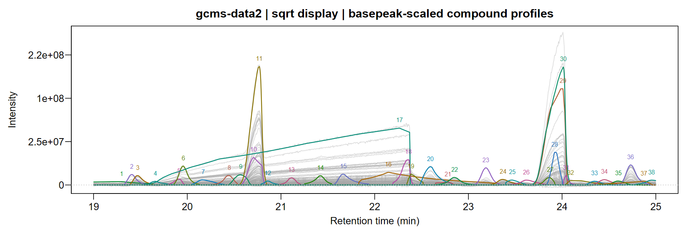
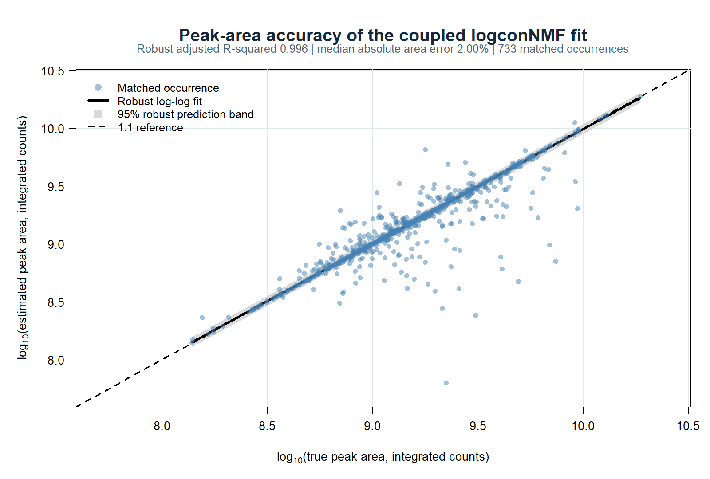
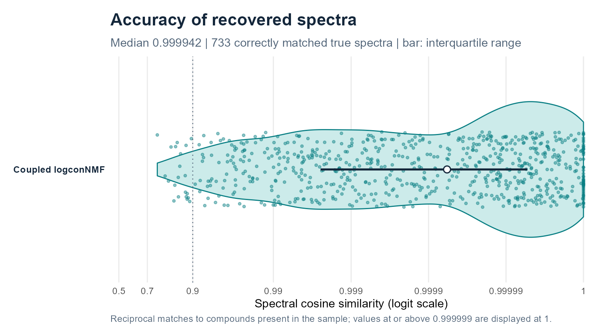
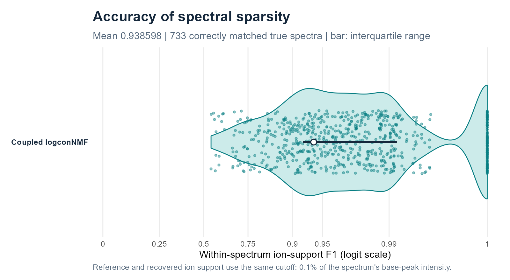
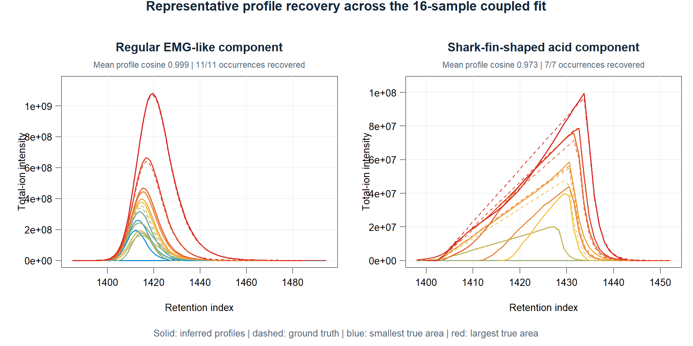

# logconNMF: Log-Concave Nonnegative Matrix Factorization with Automatic Rank Selection

<a href="https://tomwenseleers.github.io/logconNMF/">
<picture>
  <source media="(prefers-color-scheme: dark)" srcset="logconNMF/man/figures/logo-dark.svg">
  <source media="(prefers-color-scheme: light)" srcset="logconNMF/man/figures/logo-light.svg">
  
</picture>
</a>

[Get started](https://tomwenseleers.github.io/logconNMF/articles/log-concave-nmf.html) · [Documentation](https://tomwenseleers.github.io/logconNMF/reference/index.html) · [Algorithm & theory](https://tomwenseleers.github.io/logconNMF/articles/algorithm.html)

## Nonnegative matrix and tensor factorisation to separate overlapping peaks

Hyphenated chromatography is a demanding test case for structured NMF and
tensor decomposition. In gas chromatography–mass spectrometry (GC–MS),
chromatographic separation is rarely complete: when compounds co-elute, the
spectrum observed at one scan is an additive mixture of their spectra. In
matrix notation,

`Y[i, ] ≈ sum_r H[i, r] * S[r, ] + background[i, ]`,

where `H[, r]` is the elution-mode factor and `S[r, ]` is the spectral-mode
factor for component `r`. Recovering the latent components is therefore a
constrained nonnegative factorisation problem: model order must be identified
while chemically meaningful structure is imposed on both modes.

Nonnegative matrix and tensor factorisation have a substantial history in
hyphenated chromatography. Important examples include
[MCR-ALS](https://doi.org/10.1039/C4AY00571F),
[NMF applied directly to GC–MS](https://doi.org/10.1016/j.talanta.2004.09.017),
[global parametric analysis of multiple GC/MS data sets](https://doi.org/10.1016/j.chemolab.2008.10.004),
[PARAFAC2 for retention-time shifts](https://doi.org/10.1002/%28SICI%291099-128X%28199905/08%2913%3A3/4%3C295%3A%3AAID-CEM547%3E3.0.CO%3B2-Y),
and the PARAFAC2-based
[PARADISe workflow](https://doi.org/10.1016/j.chroma.2017.04.052).
These methods established that multichannel structure can resolve co-elution
and recover spectra with less interference than apex extraction alone.
For the factorisation community, these data expose where unconstrained
bilinear models and rigid multilinear coupling become fragile: rank, profile
geometry, observation noise, background and between-sample variation all
interact.

### What standard formulations leave unresolved

- **Optimisation and chemical rank.** Bilinear and multilinear factorisations
  are nonconvex. Different starts can give different stationary solutions,
  while ALS algorithms may enter long *swamps* or stop at a poor local fit
  ([Boutsidis & Gallopoulos, 2008](https://doi.org/10.1016/j.patcog.2007.09.010);
  [Tomasi & Bro, 2006](https://doi.org/10.1016/j.csda.2004.11.013)). The number
  of components is usually supplied or selected outside the main fit. Useful
  diagnostics and automated classifiers exist for PARAFAC/PARAFAC2
  ([Bro & Kiers, 2003](https://doi.org/10.1002/cem.801);
  [Johnsen et al., 2014](https://doi.org/10.1002/cem.2575)), but require fitting
  and comparing a sequence of prespecified ranks.
- **Peak geometry.** Nonnegativity alone permits multimodal or jagged elution
  profiles. MCR-ALS can impose unimodality
  ([Bro & Sidiropoulos, 1998](https://doi.org/10.1002/%28SICI%291099-128X%28199807/08%2912%3A4%3C223%3A%3AAID-CEM511%3E3.0.CO%3B2-2)),
  but unimodality by itself permits shoulders, plateaus and irregular tails.
  Log-concavity is stronger: on the positive support,
  `diff(log(h), differences = 2) <= 0`, which implies unimodality while still
  allowing asymmetric and long-tailed peaks.
- **Instrument response, background and noise.** Standard factorisations do
  not jointly estimate a constant or smoothly time-varying point-spread
  function (PSF) and a smooth nonnegative background. Least squares also
  imposes a constant-variance Gaussian working model. Ion production and
  arrival motivate count models, while detector gain, aggregation and chemical
  variability can produce overdispersion or approximately Gaussian intensities
  ([Ipsen, 2015](https://doi.org/10.1021/ac503554u)). Poisson MCR is possible
  ([Lavoie et al., 2016](https://doi.org/10.1016/j.chemolab.2016.02.006)), but
  it is a specialised extension rather than the usual MCR-ALS objective.
- **Multiple samples.** PARAFAC assumes trilinearity: apart from an amplitude,
  each compound has the same elution profile in every sample. Shifted PARAFAC
  adds translations but not compound- and concentration-specific broadening or
  tailing. Classical PARAFAC2 is more flexible, but still requires
  `t(H_s) %*% H_s = Phi` for every sample `s`. Retention shifts can preserve
  these cross-products; changing widths, tails and pairwise overlaps generally
  do not. Flexible and fully constrained PARAFAC2 variants relax important
  parts of this restriction
  ([Cohen & Bro, 2018](https://doi.org/10.1007/978-3-319-93764-9_9);
  [Roald et al., 2022](https://doi.org/10.1137/21M1450033)).

| Method (typical cited formulation) | Rank selection | Chromatographic profile | Nonnegativity | Joint component selection across channels | Noise objective | Multiple samples |
|:--|:--|:--|:--|:--|:--|:--|
| [NMF for GC–MS](https://doi.org/10.1016/j.talanta.2004.09.017) | Supplied externally | No hard peak-shape constraint | Both matrix factors | No | Usually Euclidean or generalized KL | Separate or concatenated fits |
| [MCR-ALS](https://doi.org/10.1016/j.aca.2020.10.051) | Supplied; external EFA/PCA diagnostics | Optional nonnegativity, unimodality and other constraints | Optional, commonly imposed | No integrated grouped subset selection | Weighted least squares by default; Poisson MCR-LLM exists | Augmented data sets; equality/trilinearity constraints can be added |
| PARAFAC / shifted PARAFAC | Supplied; external diagnostics | One shared profile per compound; shifted variant adds translation | Optional | No | Least squares in standard algorithms | Exact trilinearity, or sample shifts only |
| [Classical PARAFAC2 / PARADISe](https://doi.org/10.1016/j.chroma.2017.04.052) | Usually supplied; multi-rank diagnostic automation has been proposed | Sample-specific profiles with a constant cross-product constraint; no hard chromatographic shape | Historically not on every mode | No | Least squares | Retention drift and restricted shape variation |
| Flexible / [fully constrained PARAFAC2](https://doi.org/10.1137/21M1450033) | Supplied externally | Optional nonnegativity, smoothness or unimodality; relaxed/flexible coupling | Can constrain every mode | No integrated grouped subset selection | Least squares in the cited formulation | More flexible drift and shape variation, with an explicit coupling penalty or constraint |

### What logconNMF adds to constrained factorisation

**logconNMF estimates the number of components from the data while fitting the
chromatographic model.** Its main design choices are:

- **Grouped discovery across detector channels.** Candidate peak positions are
  initially selected as rows of a multichannel coefficient matrix, so evidence
  is pooled across the mass channels rather than thresholded ion by ion.
- **Automatic rank tuning.** Score additions, deletions and fusions by penalised
  likelihood to obtain the most parsimonious rank.
- **Hard log-concave profiles.** Every retained elution profile is nonnegative,
  contiguous and log-concave. The condition is stronger than unimodality and is
  enforced during fitting rather than applied as a post-hoc peak cleanup.
- **PSF estimation without a universal final peak shape.** `estimatePSF()` can
  estimate a constant or smoothly time-varying instrument response for sparse
  initialisation. The factorisation then gives every compound occurrence its
  own log-concave profile, allowing compound- and concentration-specific widths
  and tails.
- **Background and noise fitted with the signal.** A nonnegative smooth basis
  models the background without subtracting it from the observations. Seven
  identity-link families cover count-like, overdispersed and continuous data.
- **Coupled samples without trilinearity.** Spectra can be shared, while each
  occurrence retains its original scan grid, profile, location and area.
  Monotone time warps model drift and compounds may be absent from samples.
- **Safeguarded local optimisation.** Structured PSF starts, grouped screening,
  original-channel refinement, profile restarts and criterion-checked fusion
  reduce sensitivity to poor starts.

The same formulation applies to other ordered multichannel signals with
nonnegative, single-peaked components.

### Installation

```r
install.packages("remotes")
remotes::install_github("tomwenseleers/logconNMF", subdir="logconNMF")
```

## Log-concave NMF for single samples

This deliberately small test window contains six co-eluting hydrocarbons and
is used to make the recovered components easy to inspect. It is not a scale
limit: logconNMF runs efficiently on full sample matrices with approximately
10,000–15,000 time scans or more. The initial dictionary `X` places a narrow
Gaussian point spread function (PSF) at each possible peak location. The
factorization can move away from that shape and gives each retained component
its own log-concave profile.

```r
library(logconNMF)
data(gcmsData1)
Y <- gcmsData1
g <- convKernel("gaussian", 65L, list(sigma = 8))
X <- convMatrix(g, nrow(Y))
fit <- logconNMF(Y, X = X, background = matrix(1, nrow(Y), 1L),
  family = quasipoisson("identity"), precluster = 16L)

fit$rank                         # estimated number of components
profiles <- fit$H                 # scans x components
loadings <- coef(fit)             # components x original channels
spectra <- coef(fit, normalize = "l1")
GIC(fit)
```

The columns of `profiles` sum to one, so each row sum in `loadings`
gives the component's total fitted signal across scans and channels.
Grouping similar channels can speed up the initial search. The reported
spectra use every original channel.


Each spectrum is displayed on a square-root relative-intensity scale.

### Beer volatiles: compound-specific log-concave peak shapes

A beer-headspace window provides a more demanding real-data example. Narrow,
partially overlapping volatiles occur alongside a broad, strongly asymmetric
acid peak. Instead of forcing one common PSF on every compound, the final
factors act as compound-specific log-concave effective peak-shape functions:
they can be narrow, broad or strongly asymmetric while remaining nonnegative
and single-peaked. The associated spectra are estimated jointly from all 518
mass channels.

[](https://tomwenseleers.github.io/GCMSprime/articles/gcms-deconvolution.html#beer-volatiles-and-a-broad-acid-peak)

Observed ion traces are shown in grey; coloured curves show the fitted
compound contributions. Component 17 captures the broad asymmetric acid signal
without imposing its shape on the narrower neighbouring peaks.

## Coupled log-concave NMF for multiple samples

For related matrices, logconNMF fits
`Y_s ≈ H_s %*% S + B_s %*% A_s`. The spectral factor `S` is shared, while
every sample retains its own scan grid, log-concave profiles `H_s`, component
areas and smooth background. Monotone time warps model retention drift, and a
component may be absent from any subset of samples. This shares chemical
information without imposing PARAFAC trilinearity or the PARAFAC2
constant-cross-product constraint.

The coupled implementation likewise scales to large experiments comprising
hundreds or even thousands of samples. Parallel sample-level operations and
blockwise, disk-backed refinement keep memory and computation manageable as
the experiment grows.

The coupled factorisation was evaluated inside a
[16-sample GC/MS benchmark](https://tomwenseleers.github.io/GCMSprime/articles/benchmarks.html)
with 100 reference compounds, 1,200 scans and 258 channels per sample. Its 769
true sample–compound occurrences include absent compounds,
concentration-dependent broadening, retention drift, a shark-fin-shaped acid,
a smooth experimental background and quasi-Poisson noise. The plots below
isolate the coupled logconNMF result; no competing GC/MS pipelines are shown.

| Quantity | Coupled logconNMF result |
|:--|--:|
| True occurrences recovered | 733 / 769 |
| Peak-level F1 | 0.921 |
| Robust adjusted log-area R² | 0.996 |
| Median spectral cosine | 0.999942 |
| Mean within-spectrum ion-support F1 | 0.939 |

Area and spectral summaries are conditional on correctly matched true
components and should therefore be read together with occurrence recovery and
false-positive counts (90 in this benchmark). Ion-support F1 applies the same
0.1% of base-peak cutoff to the reference and recovered spectra.

[](logconNMF/man/figures/coupled-benchmark-area-accuracy.png)

Peak-area accuracy: robust adjusted R² 0.996 and median absolute area error
2.00% over 733 matched occurrences.

[](logconNMF/man/figures/coupled-benchmark-spectral-accuracy.png)

Spectral accuracy: median cosine similarity 0.999942 for 733 correctly matched
true spectra.

[](logconNMF/man/figures/coupled-benchmark-spectral-sparsity.png)

Spectral sparsity: mean within-spectrum ion-support F1 0.939 under the shared
0.1% cutoff.

[](logconNMF/man/figures/coupled-benchmark-elution-profiles.png)

Representative sample-specific profiles: solid inferred curves and dashed
ground truth for a regular component and the acid-shaped component.

The [coupled tutorial](https://tomwenseleers.github.io/logconNMF/articles/coupled-nmf.html)
explains shared spectra, sample-specific profiles, missing compounds and the
common rank-selection objective in detail.

## Choose a workflow

| Data and objective | Method |
|:--|:--|
| Estimate a common response shape from a standard or overlapping signals | [Estimate PSFs](https://tomwenseleers.github.io/logconNMF/articles/estimate-psf.html) with `estimatePSF()`. The returned sparse design can use a constant or time-varying PSF. |
| Resolve components with individual shapes in one matrix | [Sparse log-concave NMF](https://tomwenseleers.github.io/logconNMF/articles/log-concave-nmf.html) with `logconNMF()`. The tutorial covers rank selection, backgrounds and flexible noise families. |
| Share spectra across related samples | [Coupled log-concave NMF](https://tomwenseleers.github.io/logconNMF/articles/coupled-nmf.html) with `logconNMF()`. Each sample retains its own scan grid, peak shapes and areas. Components may be absent from individual samples. |

For a known and common PSF, [L0glm](https://tomwenseleers.github.io/L0glm/articles/deconvolution.html)
fits the sparse convolution model directly. [GCMSprime](https://tomwenseleers.github.io/GCMSprime/)
uses logconNMF for chromatogram files, retention-index calibration and library
search. The [algorithm and theory](https://tomwenseleers.github.io/logconNMF/articles/algorithm.html) give the
objectives, shape constraints and mathematical pseudocode.

## Selected literature

The comparison above draws on the following methodological and
chromatography-specific work.

**Matrix factorisation and curve resolution**

- de Juan A, Jaumot J, Tauler R (2014).
  [Multivariate Curve Resolution (MCR). Solving the mixture analysis problem.](https://doi.org/10.1039/C4AY00571F)
- de Juan A, Tauler R (2021).
  [Multivariate Curve Resolution: 50 years addressing the mixture analysis problem—A review.](https://doi.org/10.1016/j.aca.2020.10.051)
- Gao H-T, Li T-H, Chen K, Li W-G, Bi X (2005).
  [Overlapping spectra resolution using non-negative matrix factorization.](https://doi.org/10.1016/j.talanta.2004.09.017)
- van Stokkum IHM, Mullen KM, Mihaleva VV (2009).
  [Global analysis of multiple gas chromatography–mass spectrometry (GC/MS) data sets: A method for resolution of co-eluting components with comparison to MCR-ALS.](https://doi.org/10.1016/j.chemolab.2008.10.004)
- Lavoie FB, Braidy N, Gosselin R (2016).
  [Including noise characteristics in MCR to improve mapping and component extraction from spectral images.](https://doi.org/10.1016/j.chemolab.2016.02.006)

**Tensor factorisation for chromatographic data**

- Bro R, Andersson CA, Kiers HAL (1999).
  [PARAFAC2—Part II. Modeling chromatographic data with retention time shifts.](https://doi.org/10.1002/%28SICI%291099-128X%28199905/08%2913%3A3/4%3C295%3A%3AAID-CEM547%3E3.0.CO%3B2-Y)
- Amigo JM, Skov T, Coello J, Maspoch S, Bro R (2008).
  [Solving GC–MS problems with PARAFAC2.](https://doi.org/10.1016/j.trac.2008.05.011)
- Johnsen LG, Amigo JM, Skov T, Bro R (2014).
  [Automated resolution of overlapping peaks in chromatographic data.](https://doi.org/10.1002/cem.2575)
- Johnsen LG, Skou PB, Khakimov B, Bro R (2017).
  [Gas chromatography–mass spectrometry data processing made easy.](https://doi.org/10.1016/j.chroma.2017.04.052)
- Cohen JE, Bro R (2018).
  [Nonnegative PARAFAC2: a flexible coupling approach.](https://doi.org/10.1007/978-3-319-93764-9_9)
- Roald M, Schenker C, Calhoun VD, Adalı T, Bro R, Cohen JE, Acar E (2022).
  [An AO-ADMM approach to constraining PARAFAC2 on all modes.](https://doi.org/10.1137/21M1450033)
- Sorochan Armstrong MD, Hinrich JL, de la Mata AP, Harynuk JJ (2023).
  [PARAFAC2×N: coupled decomposition of multi-modal data with drift in N modes.](https://doi.org/10.1016/j.aca.2023.340909)

**Shape constraints, rank diagnostics and statistical modelling**

- Bro R, Sidiropoulos ND (1998).
  [Least squares algorithms under unimodality and non-negativity constraints.](https://doi.org/10.1002/%28SICI%291099-128X%28199807/08%2912%3A4%3C223%3A%3AAID-CEM511%3E3.0.CO%3B2-2)
- Eilers PHC (2005).
  [Unimodal smoothing.](https://doi.org/10.1002/cem.935)
- Bro R, Kiers HAL (2003).
  [A new efficient method for determining the number of components in PARAFAC models.](https://doi.org/10.1002/cem.801)
- Boutsidis C, Gallopoulos E (2008).
  [SVD based initialization: a head start for nonnegative matrix factorization.](https://doi.org/10.1016/j.patcog.2007.09.010)
- Tomasi G, Bro R (2006).
  [A comparison of algorithms for fitting the PARAFAC model.](https://doi.org/10.1016/j.csda.2004.11.013)
- de Rooi JJ, Eilers PHC (2011).
  [Deconvolution of pulse trains with the L0 penalty.](https://doi.org/10.1016/j.aca.2011.05.030)
- Ipsen A (2015).
  [Derivation from first principles of the statistical distribution of the mass peak intensities of MS data.](https://doi.org/10.1021/ac503554u)

## Citation

An article describing the methods implemented in logconNMF is in preparation.
If you use the package before the article is formally published, we would
appreciate a citation to the package:

Wenseleers T, Vanderaa C (2026).
*logconNMF: Log-Concave Nonnegative Matrix Factorization with Automatic Rank Selection*.
R package version 0.1.0.9000,
<https://tomwenseleers.github.io/logconNMF/>.

The [Authors and Citation page](https://tomwenseleers.github.io/logconNMF/authors.html#citation) also provides the
citation in BibTeX format. Please also cite the methodological sources linked
in the help pages where relevant.

## Acknowledgements

OpenAI Codex, using GPT-6 Astra and GPT-6.1 Sol, was used to optimize and
refactor code and help draft the documentation. The key ideas and methodological
decisions are the authors' own, and the authors take full responsibility for the
work presented here.
