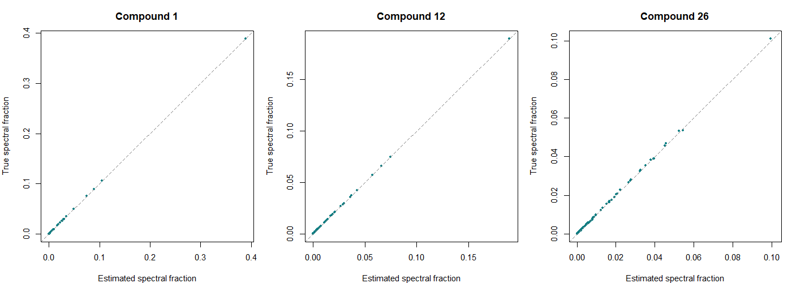

`logconNMF()` combines related multichannel samples into a common spectral
library while fitting each sample's own compound areas, peak shapes and smooth
background. Samples retain their measured time grids. The model accommodates
retention-time drift, concentration-dependent widths and tails, and compounds
that occur in only some samples.

Ignoring backgrounds and offsets, the model is \(Y_s\approx Q_sP\), with one
shared nonnegative spectral factor \(P\) and sample-specific profile/area
factors \(Q_s\). This is **simultaneous NMF** in the terminology of
[Cichocki et al.](https://doi.org/10.1002/9780470747278),
[Badea](https://psb.stanford.edu/psb-online/proceedings/psb08/badea.pdf) and
[Lee et al.](https://doi.org/10.1371/journal.pone.0048238). It is an exact
shared-factor model.

```r
fit <- logconNMF(samples, family=quasipoisson("identity"), precluster=32L)
fit$rank                          # estimated number of shared compounds
fit$areas                         # samples x consensus compounds
coef(fit, normalize="l1")          # common spectra
fitted(fit, sample=1L)             # original-grid fitted signal
sampleNMF(fit, sample=1L)          # standard per-sample NMF object
GIC(fit)
```

Each sample description contains `y`, `time`, and either a candidate PSF matrix
`X` or an independent `logconNMF()` fit. Matrices can be supplied through RDS
paths. Observations, factors, weights and offsets are stored per sample.
Each independent worker loads one sample into memory. During simultaneous refinement,
original observations and factor checkpoints remain in per-sample files,
and spectral updates read the original ions in blocks. Shared spectra and
compact alignment summaries stay in memory.

## Three samples, shared spectra and different peak shapes

The simulator provides exponentially modified Gaussian peaks, broad triangular
acid profiles, smooth backgrounds and irregular scan intervals. Peak width,
tailing and retention time can depend on concentration and position in the
chromatogram. `presence=0.5` makes compounds absent independently in half of the
samples on average.

```r
sim <- simulateGCMSSamples(samples=3L, n=c(580L,600L,620L), k=26L,
  preset="time_area_acid", presence=0.5, seed=811)

samples <- lapply(sim$samples, function(s) list(
  y=s$Y, time=s$time, edges=s$edges, exposure=s$raw_exposure,
  sample_id=s$sample_id,
  X=convMatrix(dnorm(-8:8, sd=1.6), nrow(s$Y)),
  background=splines::bs(s$time, df=4L, intercept=TRUE),
  small_width=2 * sqrt(2 * log(100)) * 1.6 * median(diff(s$time))))

fit <- logconNMF(samples, family=poisson("identity"), ncores=8L,
  control=list(initial=list(profile_cycles=4L, fusion_passes=2L)))
fit$areas
plot(fit, type="profiles", compounds=c(1L,12L))
```

The three-sample validation retains all **258 mass channels**. With every
compound present, it recovers **26 shared compounds and all 78 occurrences**.
With `presence=0.5`, the realized data contain **23 shared compounds and 37
occurrences**, all recovered. Missing occurrences remain `NA` in the area table.

| Simulation | True shared compounds | Recovered | True occurrences | Recovered | False calls | Total time |
|:--|--:|--:|--:|--:|--:|--:|
| All compounds present | 26 | 26 | 78 | 78 | 0 | 20.80 s |
| 50% presence probability | 23 | 23 | 37 | 37 | 0 | 17.87 s |

Each timing includes independent fits, alignment, grouping and simultaneous
refinement, with a budget of eight logical cores and one BLAS thread per
worker on an Intel Core i9-11950H. Simulation is excluded. Recovery uses the
nearest normalized true spectrum, with cosine similarity at least 0.9 and a
single match per compound within each sample.


Shared spectra are estimated from all detected occurrences of a compound:



## Sixteen samples with parallel fitting

A 16-sample simulation contains 100 reference compounds, 1,200 scans and
258 ion channels per chromatogram. Compounds occur in about half the
samples, giving 769 true occurrences. Concentration-dependent EMG profiles,
one acid-like compound, retention drift and an experimentally derived smooth
background create overlapping signals on the original acquisition grids.
The generating quasi-Poisson dispersion is 783.18; the fitted median is 829.55.

The [GCMSprime CDF workflow](https://tomwenseleers.github.io/GCMSprime/articles/multisample.html#sixteen-simulated-chromatograms),
built on logconNMF, recovers **750 true occurrences with 142 false positives**
(peak F1 **0.903**), including the acid in all seven samples where it occurs.
It takes **149.31 s** with 16 single-threaded workers on an HP ZBook Fury G8
with an Intel Core i9-11950H, eight physical cores and 16 logical threads.
The common 32-group map accelerates initialization; final spectra retain all
258 original channels.


The [seven-workflow comparison](https://tomwenseleers.github.io/GCMSprime/articles/benchmarks.html)
reports areas, spectral similarities, within-spectrum sparsity and component
counts. GCMSbenchmark includes the simulation and complete rerun recipe.


## Full-sized simultaneous factorization

A separate resource validation uses **16 chromatograms with 10,000 scans and
550 recorded mass bins each**. There are 1,000 reference compounds, present
independently in half the samples on average: the realized data contain
7,917 true occurrences, roughly 500 per sample. Library
compound ions occupy 258 of the recorded bins; the other bins retain background
observations. The simulator includes concentration-dependent EMG widths and
tails, retention drift, irregular scan intervals, a smooth experimental-window
background and one acid-like compound, present in eight samples. The generating
quasi-Poisson dispersion is 783.18.

The GCMSprime CDF wrapper supplies the PSF designs and backgrounds to logconNMF.
It uses the package defaults, a calibrated narrow-peak standard,
time-varying sample PSFs and at most 32 common ion groups. `ncores=NULL` selects
**16 single-threaded workers** on the test machine. Original channels enter
the likelihood checks and final spectra. Input simulation and the separate
standard calibration are outside the workflow timing.

| Quantity | Measured result |
|:--|--:|
| True peak occurrences recovered | 7,864 / 7,917 |
| False positives / false negatives | 131 / 53 |
| Occurrence F1 | 0.9884 |
| Estimated shared components | 1,129 |
| Joint quasi-GIC | 86,522,402 |
| Median spectral cosine | 0.9999977 |
| Mean within-spectrum ion F1 | 0.978 |
| Mean profile cosine | 0.9994 |
| Median absolute area error | 0.239% |
| Acid occurrences recovered | 8 / 8 |

Scoring uses maximum-cardinality one-to-one matching within 0.25 minutes and
spectral cosine at least 0.9; ion-support F1 uses the shared 0.1% base-peak
threshold. Area, spectrum and profile summaries condition on correct matches.
All acid occurrences are detected; one difficult overlap still gives a distorted
acid profile. This resource test is separate from the RI-aware reciprocal-hit
seven-workflow comparison above.

| Workflow stage | Seconds |
|:--|--:|
| Common ion grouping | 18.72 |
| Parallel independent fits, including sample PSFs | 928.45 |
| Alignment, grouping and simultaneous refinement | 2059.51 |
| Result construction and exports | 45.60 |
| Package-reported workflow total | 3052.28 |

The workstation is an HP ZBook Fury G8 with an Intel Core i9-11950H at 2.60 GHz,
eight physical cores, 16 logical threads and 64 GB RAM, running Windows and
R 4.5.0. Sampled peak combined private memory is **22.86
GiB**, and peak summed working set is **18.61 GiB**;
at least **23.59 GiB** of physical memory remains
available. These measurements include active workers and fitting workspaces,
not just the 40.96 MB aggregate observation cache. Mean CPU use over the complete
run is 11.67 logical-core equivalents. The independent process-tree monitor
records 3,054.88 s, including R startup and the final saved result.


The acid display subtracts each true 1%-height onset to compare shapes. Fitting
uses the original scan grid. Curves retain their original count amplitudes;
they are not normalized to unit height or area.

The [complete reproducible script](https://github.com/tomwenseleers/GCMSprime/blob/master/benchmarks/benchmark_fullsize_16.R)
and [compact measured results](https://github.com/tomwenseleers/GCMSprime/tree/master/benchmarks/results/fullsize16)
are supplied with the source. From the GCMSprime repository root:

```r
source("benchmarks/benchmark_fullsize_16.R")
benchmarkFullsize16(stage="prepare")
benchmarkFullsize16(stage="fit")
benchmarkFullsize16(stage="score")
```

The generated CDF files and persistent fitted store are written to
`codex_sandbox/fullsize16` by default. Use `directory=` to select another location.

## Original scan grids, shared spectra and missing compounds

Each sample retains its measured time grid, background and noise parameters.
Monotone alignment changes profile coordinates and bin widths; observations
are evaluated directly without resampling. Each detected occurrence has its
own log-concave shape and amplitude, while its spectrum is shared.

The joint criterion counts one unit-sum spectrum per consensus component and
one amplitude per detected occurrence. Profile and background complexity are
unpenalized. Original-channel likelihood checks decide whether a complete
grouped/refined candidate is retained.

```r
fit$areas
fit$compounds
fit$alignment
single <- sampleNMF(fit, sample=1L)
dim(single$H)
dim(coef(single))
plot(fit, type="areas")
```

An absent occurrence stays `NA`; this model does not fill undetected compounds.
The [simultaneous model and algorithm](algorithm.html#simultaneous-model) give the exact
likelihood, Jacobian, normalization, pooled spectral updates and rank charge.

## Noise, exposure and disk-backed fitting

Gaussian, Poisson, quasipoisson, NB2, NB1, censored Gamma and common-scale Gamma
are supported. Noise parameters are shared over channels within each sample.
Use positive `dispersion`/`theta` to fix known parameters; negative NB2 `theta`
enables bounded likelihood-improving updates from its absolute starting value.

Known observation exposure can be given as a scalar or scan vector in each
sample description. It multiplies the mean; the identity-link `offset` adds
known signal. The default unit exposure preserves the units of supplied data.
Alignment's change in bin widths preserves integrated occurrence areas.

Observation matrices and factor checkpoints are stored per sample on disk.
Each worker uses its assigned sample's factors and observations. Shared spectra,
areas and matching structures stay in memory. Spectral, background and score
passes stream original-channel blocks; other-family profile passes can load
one assigned original sample per worker. By default only the common
aggregate observations are cached across samples, using 2.56 GB for 1,000
samples with 10,000 scans and 32 groups. Compatible profile checks can also
use an original-channel read buffer up to 64 MiB per active worker. Set
`control=list(cache=FALSE)` to
read those data from disk. `ncores=NULL` uses the detected logical core count
for a sample list; `control$workers` can cap concurrency. With at least 16
samples and 16 logical cores, the default is 16 single-threaded workers. Supply `y` or independent
`fit` components as RDS paths for file-backed input; use a new `path=` for each
fit's persistent store. Keep that store alongside saved fitted objects.

The native kernel pools spectral scores over sparse profile supports and uses
OpenMP over channels. On 14,949 scans, 518 channels and 325 profiles, one pooled
score pass took 0.16 s; the [implementation details](algorithm.html#simultaneous-algorithm)
describe the update and threading structure.

For sample-group directories, acquisition ordering, alkane standards and
Excel/MSP reports, use the workflow in
[GCMSprime](https://tomwenseleers.github.io/GCMSprime/articles/multisample.html).
